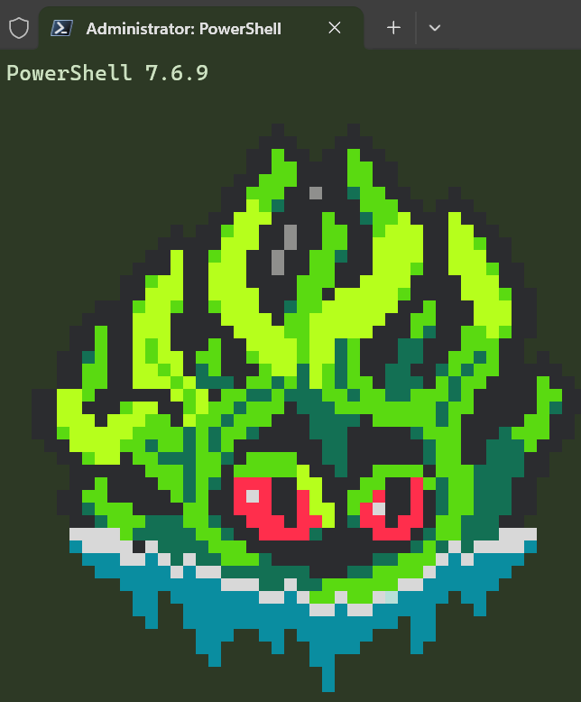
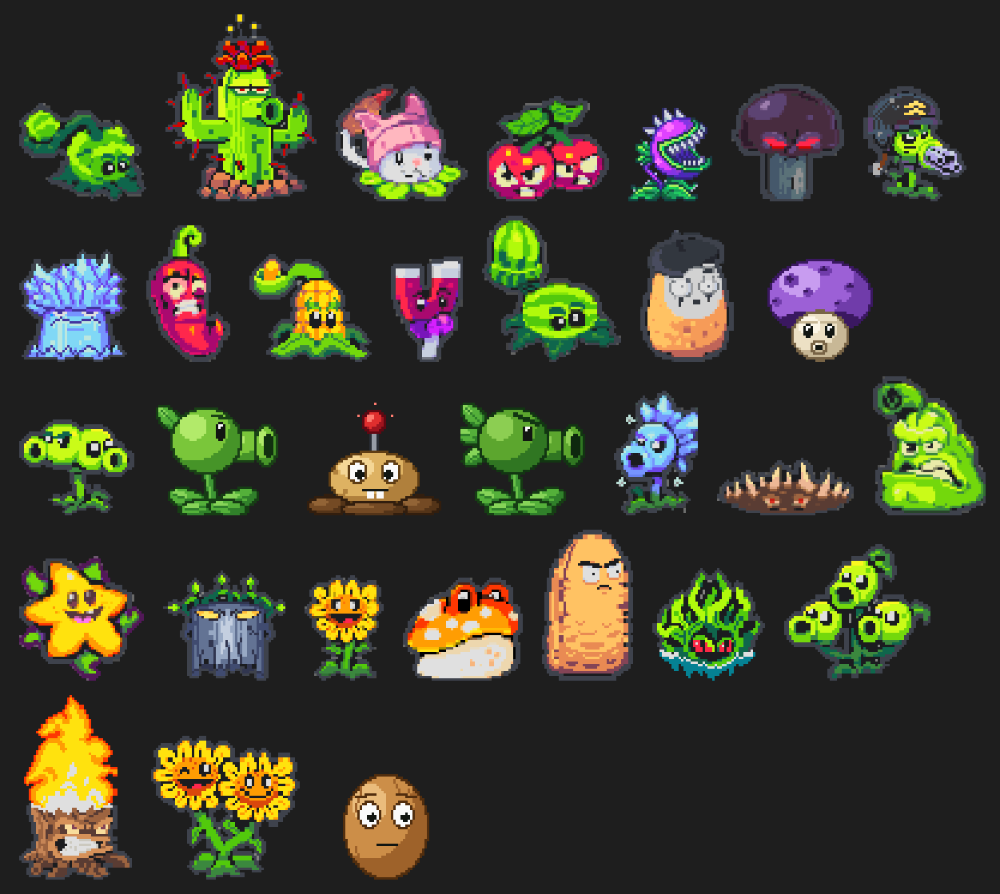

# Terminal plant banner



Shows a big pixel-art plant when a terminal opens, and tints the terminal to match it. There is
a bash/zsh version and a PowerShell version, so it runs on Linux, macOS and Windows, locally or
over ssh.

The art is drawn with truecolor half-block characters (two pixels per character cell), so it
needs a terminal with 24-bit colour, which most modern terminals have.



All 50 plants come with the repository. One is picked at random each time.

## Install

Both versions need Python 3 once, to build the banners. Nothing else is required.

### bash or zsh (Linux, macOS, any Unix-like system)

```bash
git clone <this repository's URL> pvz-banner
cd pvz-banner
bash install.sh
```

This builds the banners and installs them for your user:

- The art goes to `~/.local/share/pvz-banner/`.
- One marked block goes into `~/.bashrc`, into `~/.bash_profile` where login shells don't read
  `~/.bashrc`, and into `~/.zshrc` if you use zsh. Each file is backed up first as
  `<file>.bak-pvz`.

Run it again to update. To uninstall, delete each block (from `# pvz-banner start` to
`# pvz-banner end`) and the folder.

Requirements: bash 4.2 or newer somewhere on the system (it doesn't have to be your login
shell), `tput` and `paste`. GNU, BSD and BusyBox tools all work.

**macOS:** the built-in bash is 3.2, so run `brew install bash` first. Your login shell can stay
zsh.

**No Python on the target machine?** Run `python3 build.py` on another one, copy `bash/build/`
over, and run the `install.sh` inside it.

### PowerShell 7+ (any OS)

```powershell
git clone <this repository's URL> "$HOME/.config/pvz-banner"
cd "$HOME/.config/pvz-banner"
python build.py        # or python3 build.py
Get-Content profile-snippet.ps1 | Add-Content $PROFILE
```

The snippet expects that folder. Open a new terminal to see a plant.

## Commands

| Command | Shows |
|---|---|
| `plants` | one random plant, as big as the window allows |
| `plants <name>` | a specific plant |
| `plants list` | the names available |
| `plants garden` | random plants side by side, filling the row |
| `plants garden 8` | eight plants, shrunk together as far as needed to fit |
| `plants reset` | puts the terminal's colours back to normal |
| `plants classic` | PowerShell only: the first, small row of plants |

A plant shows once per terminal session, in a new local terminal or when you ssh in. It only
draws in an interactive shell on a real terminal at least 60 columns wide, so `ssh host command`,
scp, rsync, cron and scripts never see it. The terminal's colours go back when the session ends.

Sizes are counted in character cells, so a bigger font behaves like a smaller window. The garden
uses the plants' real size when at least three fit, and otherwise shrinks them all by the same
amount until three do.

Settings:

- bash/zsh: `PLANTS_THEME=0` turns the tinting off.
- PowerShell: `$PlantsTheme` turns the tinting on or off, and `$PlantsOnStart` sets what a new
  terminal shows (`random`, `garden`, `classic`, a plant name, or `off`).

## Terminal support

The tint uses the standard colour escape codes. A terminal that doesn't know a code ignores it,
and the art still draws.

Tested in Windows Terminal, iTerm2, Ghostty and macOS Terminal.app.

| Terminal | Notes |
|---|---|
| Windows Terminal | tints background, text, cursor and selection |
| iTerm2 | also tints the tab; see below for the cursor guide |
| Ghostty | tints background, text and cursor; the selection keeps the colours from your Ghostty config |
| macOS Terminal.app | needs a line-spacing change, see below |

**iTerm2 cursor guide.** Escape codes can't set the cursor guide's colour or restore the
selection afterwards. The optional script `iterm2/pvz_banner.py` does both through iTerm2's Python
API. `install.sh` copies it into iTerm2's `Scripts/AutoLaunch` folder. To switch it on, enable
Settings > General > Magic > Enable Python API, run Scripts > Manage > Install Python Runtime,
and restart iTerm2. It acts on local sessions only, not over ssh.

**Terminal.app shows thin lines through the art.** It draws the block characters with the font,
and at the default spacing they don't fill the line. Open Terminal > Settings > Profiles, pick
your profile, open the Text tab, and lower the line spacing until the lines close up. With Menlo,
about 0.805 works.

## Adding your own plants

This needs Pillow as well as Python 3. Pixel art on a plain background works best.

```
python3 from_image.py <picture> <name>
python3 build.py
```

Then run `bash install.sh` again for the bash/zsh version.

Options for `from_image.py`:

| Option | Use |
|---|---|
| `--pitch N` | size of one art pixel in the picture, if the automatic guess is off |
| `--snap` | follow the picture's real pixel edges; fixes blur in screenshots |
| `--main` | keep only the biggest sprite |
| `--drop R,G,B` | remove a colour, such as a ground shadow |
| `--merge N` | fold colours closer than N together (default 26); removes speckle |
| `--crop l,t,r,b` | use only part of the picture |
| `--png` | also write `check-<name>.png` to inspect the result |

For a sprite sheet, `python3 split_sheet.py <sheet>` cuts it into `refs/sheet/NN.png` and writes
an `index.png` with each sprite's number on it. Convert each piece with `from_image.py`; a sheet
of screenshotted pixel art usually needs `--snap --main --merge 36` and a matching `--pitch`.

**Pillow on macOS:** install it into the same `python3` you run the scripts with:
`python3 -m pip install --user --break-system-packages pillow`. `brew install pillow` can land in
a different Python. `python3 -c "import PIL"` tells you whether yours can see it.

## Files

| File | What it does |
|---|---|
| `install.sh` | builds and installs the bash/zsh version |
| `build.py` | builds every size, the colour themes and the bash bundle |
| `out/big-*.ans` | the 50 plants; everything else in `out/` is built from them |
| `bash/` | the bash/zsh version: `plants.sh`, its installer and `test.sh` |
| `profile-snippet.ps1` | the PowerShell version |
| `iterm2/pvz_banner.py` | optional iTerm2 companion script |
| `from_image.py`, `split_sheet.py` | convert a picture, or cut up a sprite sheet |
| `make_big.py`, `make_banner.py` | the mushroom drawn in code, and the classic row |
| `make_small.py`, `make_scaled.py` | the smaller copies, and the 2x and 3x copies |
| `make_themes.py`, `make_bash.py` | a colour theme per banner, and the bash bundle |
| `render_ans.py` | draws banners as a PNG image |
| `ps-test.ps1`, `bash/test.sh` | check every view fits a range of window sizes |

## Credits

The plants were converted from pixel art by [TomcArts01](https://tomcarts01.newgrounds.com/):
[PvZ All Plants Pixel Art](https://www.newgrounds.com/art/view/tomcarts01/pvz-all-plants-pixel-art)
on Newgrounds. Go look at the original.

The plants are characters from *Plants vs. Zombies* by PopCap Games / Electronic Arts. This is an
unofficial fan project with no connection to them.
